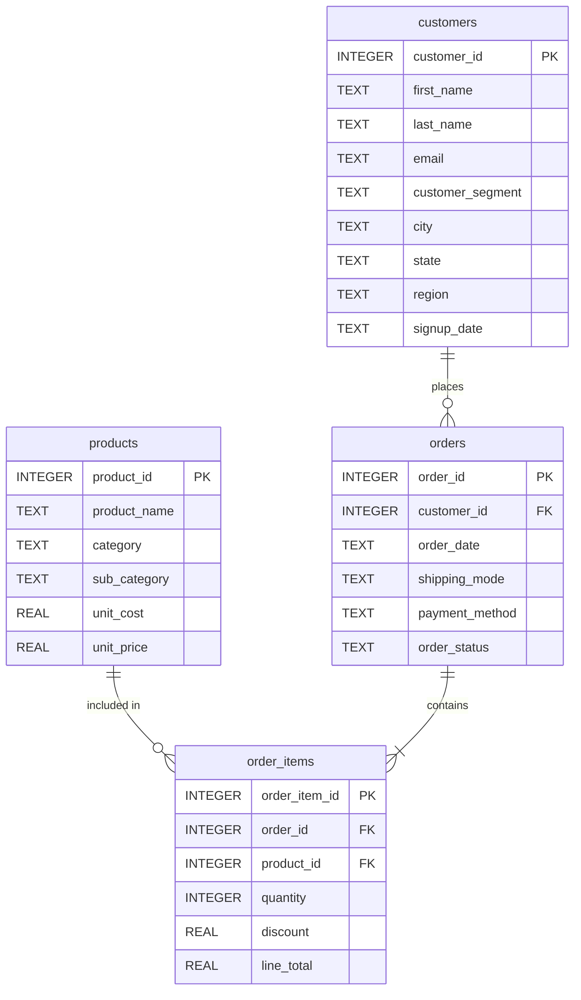

# NovaMart Retail Sales & Customer Analytics Portfolio Project

[](https://en.wikipedia.org/wiki/SQL)
[](https://www.microsoft.com/en-us/microsoft-365/excel)
[](https://www.sqlite.org/)
[](#)

A comprehensive, end-to-end Data Analytics portfolio project demonstrating **Relational Database Design**, **Business SQL Querying**, **Financial Modeling in Microsoft Excel**, and **Executive Dashboard Reporting**.

---

## 📌 Executive Summary

**NovaMart** is an omnichannel consumer retailer offering products across four core categories: **Electronics, Home & Kitchen, Apparel, and Beauty & Health** across four geographic regions in the United States.

### The Business Challenge
During a recent executive review, NovaMart leadership noticed that despite top-line sales growth, operating profit margins were tightening. The executive team lacked visibility into:
1. Which product categories and items drive volume versus high profit margin.
2. How promotional discounting impacts gross margin percentages.
3. Customer retention patterns and the lifetime value of repeat buyers.
4. Regional sales distribution and Average Order Value (AOV).

### Core Project Deliverables
- **Relational SQL Database (`novamart.db`):** 4 normalized tables, primary/foreign key constraints, and performance indexes.
- **10 Production-Ready SQL Business Queries:** Aggregations, CTEs, window functions, conditional bucketing, and multi-table joins.
- **Interactive Microsoft Excel Workbook (`NovaMart_Sales_Analysis.xlsx`):** Executive KPI cards, monthly trendlines, category margin comparisons, customer retention tables, and full formula modeling.
- **Actionable Business Recommendations:** 5 strategic recommendations for the CFO, Head of Merchandising, and VP of Sales.

---

## 📊 Key Business Performance Indicators (KPIs)

*All metrics are verified from completed orders spanning fiscal years 2023–2024:*

| Metric | Verified Value | Description / Calculation |
| :--- | :---: | :--- |
| **Total Completed Orders** | **1,092** | Orders with status `Completed` (91.0% completion rate) |
| **Active Customers** | **245** | Unique paying customers across 2023–2024 |
| **Total Units Sold** | **2,676** | Aggregate volume of units purchased |
| **Total Net Revenue** | **$174,869.31** | Sum of actual checkout values after discounts |
| **Cost of Goods Sold (COGS)** | **$71,543.40** | Unit acquisition cost × Quantity |
| **Total Gross Profit** | **$103,325.91** | Revenue minus Cost of Goods Sold |
| **Overall Gross Margin %** | **59.09%** | Gross Profit / Total Revenue |
| **Average Order Value (AOV)** | **$160.14** | Total Revenue / Completed Orders |

---

## 🗄️ Database Architecture & Schema

The database is built on a 3rd Normal Form (3NF) relational model to eliminate data redundancy and mirror enterprise retail systems.



### Data Hygiene & Validation
- **0 Foreign Key Violations:** Verified via `PRAGMA foreign_key_check`.
- **Constraint Enforcement:** Check constraints ensure `quantity > 0`, `discount BETWEEN 0 AND 0.30`, and `unit_price >= unit_cost`.
- **Deterministic Dataset:** Generated with a fixed seed (`random.seed(42)`), guaranteeing 100% mathematical consistency across SQL, CSV files, and Excel formulas.

---

## 🔍 Featured Business SQL Queries

The full suite of 10 queries is documented in [`sql/02_business_queries.sql`](file:///w:/projectsql/sql/02_business_queries.sql). Below are three core analytical highlights:

### 1. Category Margin & Volume Trade-off
```sql
SELECT 
    p.category,
    COUNT(DISTINCT o.order_id) AS orders_count,
    SUM(oi.quantity) AS units_sold,
    ROUND(SUM(oi.line_total), 2) AS total_revenue,
    ROUND(SUM(oi.line_total - (oi.quantity * p.unit_cost)), 2) AS total_profit,
    ROUND((SUM(oi.line_total - (oi.quantity * p.unit_cost)) / SUM(oi.line_total)) * 100, 2) AS profit_margin_pct
FROM order_items oi
JOIN products p ON oi.product_id = p.product_id
JOIN orders o ON oi.order_id = o.order_id
WHERE o.order_status = 'Completed'
GROUP BY p.category
ORDER BY total_revenue DESC;
```
**Results:**
- **Electronics:** $73,607.48 Revenue | $37,426.48 Profit | **50.85% Margin**
- **Home & Kitchen:** $42,858.18 Revenue | $25,487.18 Profit | **59.47% Margin**
- **Apparel:** $34,119.02 Revenue | $23,061.52 Profit | **67.59% Margin**
- **Beauty & Health:** $24,284.63 Revenue | $17,350.73 Profit | **71.45% Margin**

*Insight:* Electronics brings in 42% of revenue, but Beauty & Health is far more efficient, yielding 71.5 cents of profit per dollar earned.

---

### 2. Discount Impact on Gross Margins
```sql
SELECT 
    CASE 
        WHEN oi.discount = 0.0 THEN '0% (No Discount)'
        WHEN oi.discount <= 0.05 THEN '5% Discount'
        WHEN oi.discount <= 0.10 THEN '10% Discount'
        WHEN oi.discount <= 0.15 THEN '15% Discount'
        ELSE '20% Discount'
    END AS discount_tier,
    COUNT(*) AS item_count,
    ROUND(SUM(oi.line_total), 2) AS total_revenue,
    ROUND(SUM(oi.line_total - (oi.quantity * p.unit_cost)), 2) AS total_profit,
    ROUND((SUM(oi.line_total - (oi.quantity * p.unit_cost)) / SUM(oi.line_total)) * 100, 2) AS profit_margin_pct
FROM order_items oi
JOIN products p ON oi.product_id = p.product_id
JOIN orders o ON oi.order_id = o.order_id
WHERE o.order_status = 'Completed'
GROUP BY discount_tier
ORDER BY profit_margin_pct DESC;
```
*Insight:* Full-price items achieve **61.51%** margin. At a 15% discount, margin drops steeply to **52.13%** (-9.38 percentage points), demonstrating that blanket discounts damage profitability without sufficiently expanding basket sizes.

---

### 3. Customer Retention & Repeat Purchase Value (CTE)
```sql
WITH customer_order_counts AS (
    SELECT 
        c.customer_id,
        COUNT(DISTINCT o.order_id) AS order_count,
        SUM(oi.line_total) AS customer_revenue
    FROM customers c
    JOIN orders o ON c.customer_id = o.customer_id
    JOIN order_items oi ON o.order_id = oi.order_id
    WHERE o.order_status = 'Completed'
    GROUP BY c.customer_id
)
SELECT 
    CASE 
        WHEN order_count = 1 THEN 'One-time Customer'
        ELSE 'Repeat Customer (2+ Orders)'
    END AS customer_type,
    COUNT(*) AS customer_count,
    ROUND((COUNT(*) * 100.0 / (SELECT COUNT(*) FROM customer_order_counts)), 2) AS customer_pct,
    ROUND(SUM(customer_revenue), 2) AS total_revenue,
    ROUND((SUM(customer_revenue) * 100.0 / (SELECT SUM(customer_revenue) FROM customer_order_counts)), 2) AS revenue_pct,
    ROUND(AVG(customer_revenue), 2) AS avg_revenue_per_customer
FROM customer_order_counts
GROUP BY customer_type;
```
*Insight:* Repeat customers comprise **86.94%** of customer count and generate **96.39% ($168,553.24)** of all company revenue, averaging **$791.33** in lifetime spend versus $197.38 for one-time buyers.

---

## 📈 Microsoft Excel Modeling & Executive Dashboard

The Excel file [`excel/NovaMart_Sales_Analysis.xlsx`](file:///w:/projectsql/excel/NovaMart_Sales_Analysis.xlsx) contains 6 structured worksheets:

1. **`Executive Dashboard`**:
   - Executive KPI Summary Cards (Revenue, Profit, Margin %, Orders, Customers, AOV).
   - Dynamic Category Revenue vs. Profit column chart.
   - Customer Segment Revenue Share doughnut chart.
   - Regional Revenue distribution bar chart.
2. **`Monthly & Category Trends`**:
   - 24-month revenue and gross profit trajectory line chart.
   - Month-over-month trend tables with dynamic Excel formulas (`SUM`, `SUMIFS`, Margin %).
3. **`Customer & Regional Insights`**:
   - Retention profile breakdown (One-Time vs. Repeat).
   - Top 10 VIP Customers ranked by lifetime spend.
   - Regional AOV and revenue analysis.
4. **`Orders_Clean_Data`**:
   - Consolidated master table of 1,869 completed line items with real Excel formulas for `Line Revenue`, `COGS`, `Gross Profit`, and `Margin %`.
   - Frozen panes and formatted currency and percentage cells.
5. **`Products_Catalog`**: Reference table of 40 catalog items with markup and cost structures.
6. **`Customers_Master`**: Master demographic and segmentation table.

---

## 💡 Key Business Insights

1. **Category Volume vs. Margin Disparity:** Electronics accounts for 42.1% ($73.6k) of total revenue but generates the lowest category profit margin (50.85%). In contrast, Beauty & Health (71.45%) and Apparel (67.59%) are under-marketed relative to their profitability.
2. **The High Cost of Flat Discounts:** Flat discounts at the 15% level reduce gross margins by nearly 10 percentage points (from 61.5% down to 52.1%).
3. **Repeat Customers Are the Lifeblood:** With 96.4% of revenue originating from repeat purchasers, customer retention and re-order velocity are the primary growth drivers.
4. **Regional Opportunity in the West:** The South ($46.8k) and Midwest ($46.7k) dominate sales, while the West lags ($36.3k) and suffers from the lowest AOV ($147.59 vs. $172.59 in the South).
5. **B2B Small Business Value:** Although Small Business accounts are fewer in number (50 accounts), they generate the highest revenue per customer ($749.53) with strong 59.7% margins.

---

## 🎯 Practical Business Recommendations

| # | Strategic Initiative | Target Stakeholder | Action Plan | Expected Impact |
| :-: | :--- | :--- | :--- | :--- |
| **1** | **High-Margin Cross-Selling** | VP of Merchandising | Bundle tech hardware with high-margin accessories and personal care items during checkout. | Lift blended margin by 2.5–3.5 percentage points. |
| **2** | **Tiered Spend Discounts** | CFO / Head of Marketing | Phase out blanket 15% promo codes; replace with "Spend $150, Save $15" spend thresholds. | Protect profit margins while elevating AOV toward $175+. |
| **3** | **B2B Small Business Program** | Sales Leadership | Introduce dedicated Small Business accounts with volume discounts and Net-30 payment terms. | Accelerate high-ticket repeat orders from small businesses. |
| **4** | **Automated Re-engagement** | Lifecycle Marketing | Trigger automated post-purchase emails on Day 14 and Day 30 offering tailored replenishment items. | Improve single-buyer conversion to repeat buyers by 15%. |
| **5** | **West Coast Logistics Review** | VP of Operations | Audit carrier delivery lead times in California and Washington; launch localized Pacific promotions. | Close the $10k regional revenue gap with the Midwest and South. |

---

## 📁 Repository Structure

```
projectsql/
│
├── README.md                           <- Executive portfolio documentation (this file)
│
├── data/
│   ├── novamart.db                     <- SQLite relational database
│   └── raw/                            <- Raw source CSV files
│       ├── customers.csv               <- 250 customer profiles
│       ├── products.csv                <- 40 catalog items
│       ├── orders.csv                  <- 1,200 order headers
│       └── order_items.csv             <- 2,060 order item lines
│
├── sql/
│   ├── 01_schema.sql                   <- DDL table creation, constraints & indexes
│   └── 02_business_queries.sql         <- 10 tested business analytical queries
│
├── excel/
│   └── NovaMart_Sales_Analysis.xlsx    <- Complete 6-sheet Excel workbook & dashboard
│
├── scripts/
│   ├── generate_and_load_data.py       <- Deterministic dataset generator & DB loader
│   ├── test_queries.py                 <- Automated SQL test and validation runner
│   └── build_excel_portfolio.py        <- Automated Excel workbook builder with charts
│
└── docs/
    └── project_summary.md              <- Executive brief for leadership
```

---

## 🚀 How to Run & Verify This Project

### 1. Prerequisites
- Python 3.8+ (with `xlsxwriter` installed: `pip install xlsxwriter`)
- SQLite3 (built into Python standard library)
- Microsoft Excel, Google Sheets, or LibreOffice Calc

### 2. Execution Steps
```bash
# 1. Clone or download the repository
cd projectsql

# 2. (Optional) Regenerate the database and raw CSV files
python scripts/generate_and_load_data.py

# 3. Run and validate all 10 SQL queries
python scripts/test_queries.py

# 4. (Optional) Rebuild the formatted Excel workbook
python scripts/build_excel_portfolio.py
```

---

## 👤 Author & Contact
- **Project Lead:** Aspiring Data Analyst / Business Analyst
- **Focus Areas:** Business Intelligence, SQL Data Modeling, Financial Analysis, Microsoft Excel
- **Feedback & Collaboration:** Open to discussions, junior analyst roles, and portfolio reviews!
